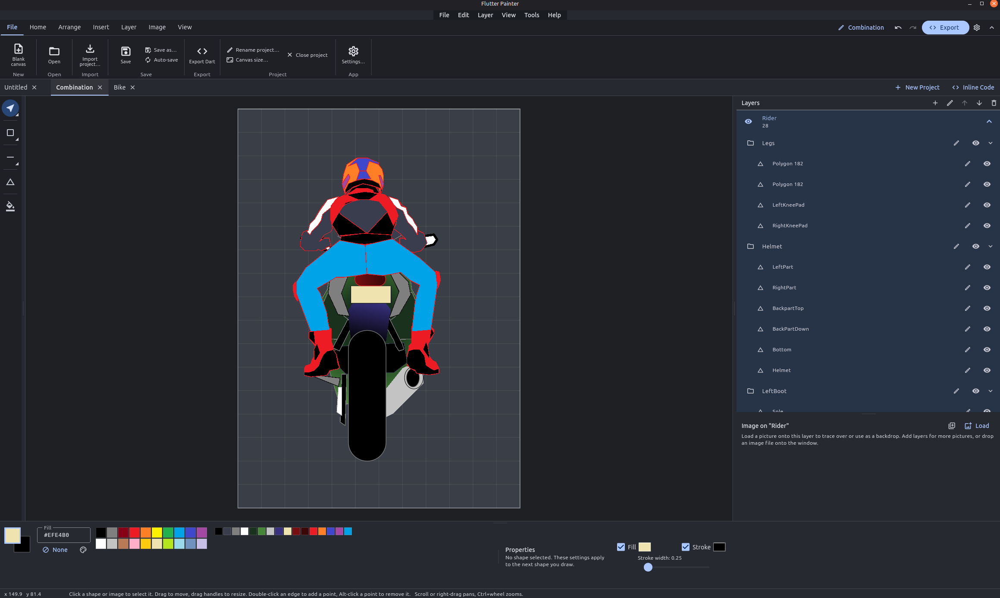
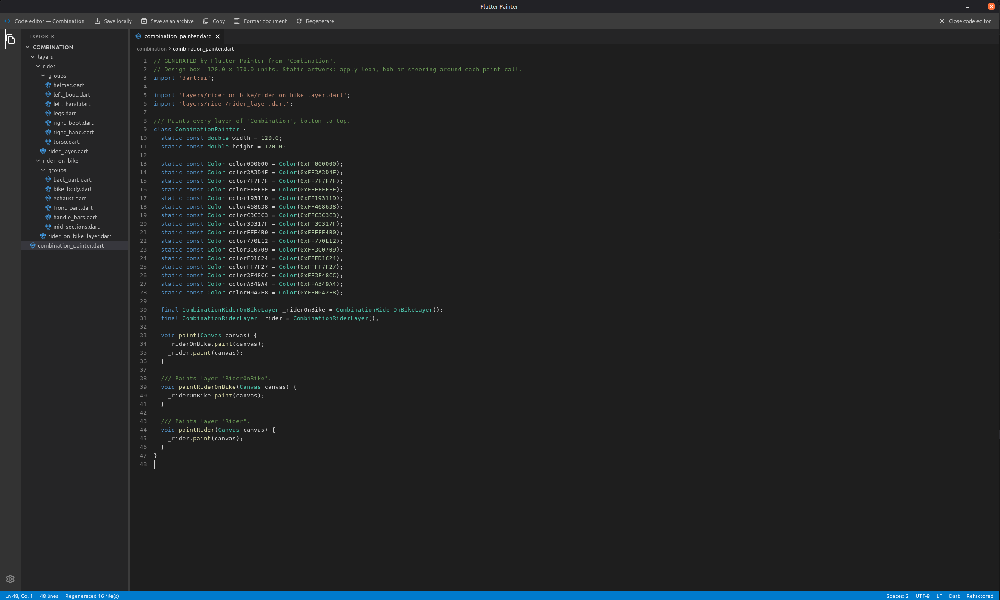

# Flutter Painter

Flutter Painter is a desktop vector drawing app for making artwork and exporting
it as Dart code. Draw with shapes and paths, arrange them on layers, and use the
generated `dart:ui` painter in a Flutter project.




## Features

- Draw rectangles, ellipses, lines, polygons, open line paths and smoothed
  freehand strokes.
- Select one or many shapes, move, resize and rotate them, or group them for
  easier editing.
- Keep artwork organized with layers and an expandable item tree. Rename items
  and groups inline, select a group or an individual member, and edit or delete
  its members separately.
- Refine polygon and line-path points by dragging, adding points on an edge, or
  using the point context menu.
- Trace over an image on any layer. The image is stored with the project.
- Keep multiple projects open in tabs, with undo, redo, auto-save and draft
  recovery.
- Export a drawing as either a refactored set of Dart files or one monolithic
  Dart file.

## Getting started

Requires Flutter with desktop support and Dart `^3.13.5`.

```sh
flutter pub get
flutter run -d linux
```

Use `-d windows` or `-d macos` on the corresponding desktop platform. Build a
release with `flutter build linux`, `flutter build windows` or
`flutter build macos`.

The Advanced workspace has a tool palette, ribbon and menus, canvas, colour
controls, and panels for layers, images and shape properties. The canvas uses a
design box (120 × 170 units by default); those units become coordinates in the
Dart output. Change the size from the canvas-size command.

The interface supports English and Swahili, light and dark themes, and minimal
or advanced layouts.

## Drawing and editing

| Tool | Use |
| --- | --- |
| Select / move | Select and move shapes. Drag a corner handle to resize, or use the rotation handle above the selection. |
| Rectangle | Drag to draw; hold Shift for a square. Set corner radius in Properties. |
| Ellipse | Drag to draw; hold Shift for a circle. |
| Line | Drag to draw; hold Shift to constrain it to 45° angles. |
| Polygon / line path | Click to add points. Click the first point or double-click to close a polygon. Press Enter for an open path or Shift+Enter for a closed polygon. |
| Freehand | Drag to draw a smoothed stroke. |
| Move / resize image | Drag the active layer's reference image or its handles. |

Drag on empty canvas to marquee-select shapes on the active layer. Hold Shift to
add to the selection. Ctrl+A selects every shape on the active layer. A selected
group moves, scales and rotates together. Shift while rotating snaps to 15°
steps. The Properties panel also has a **Scale down 10%** action.

### Points, groups and the item tree

With a polygon or line path selected:

- Drag a point to move it. Double-click an edge to insert a point.
- Alt-click a point to delete it, or right-click a point for **Delete this
  point** and **Split this point**. Split inserts a midpoint on an adjacent
  segment.
- Points cannot be deleted below the minimum needed to keep a valid polygon or
  line path.

Use **Group** and **Ungroup** in the arrange commands to manage selected shapes
together. Groups start with names such as `Group 1`. In the Layers panel, expand
a layer to see its items and groups. Click a group to select its members
together, or click a child item to select it on its own. Rename either inline.
You can edit, move or delete an individual group member without ungrouping the
rest.

### Colour and stroke

Choose whether the fill or stroke swatch is active, then click a palette colour
to apply it. Right-click a palette colour to set the stroke. The hex field
accepts `#RRGGBB` and `#AARRGGBB`. The colour picker supports solid and gradient
fills; stroke width and rectangle corner radius are available in Properties.

With a shape selected, these controls edit it. With no shape selected, they set
the style for the next shape. The grid and snap controls help align points.

## Layers and reference images

Layers draw from bottom to top. Add, rename, reorder, hide or delete them from
the Layers panel. New shapes go on the active layer. Each layer can hold a
reference image as well as shapes.

Load an image from the image panel or drop a PNG, JPG, WebP, BMP or GIF onto the
window. Adjust its opacity, visibility, position and size while tracing. Fit
to canvas resets its placement. Reference images are embedded in the `.flp`
project and are not included in Dart code.

## Projects, saving and recovery

Each project has its own tab and undo history. Open `.flp` projects with the
Open command or drop one or more files onto the window. Dropping an image adds
it to the active layer, or to a new layer if the active layer already has an
image. Closing the last tab opens a fresh blank project.

Projects use the readable JSON `.flp` format. Plain `.json` drawing files can
also be opened. When saving, the app keeps the project and its generated code
together in a folder named after the project file. For example, saving as
`Rider.flp` creates:

```text
Rider/
├── Rider.flp
├── rider_painter.dart
└── layers/
    ├── bike/
    │   ├── bike_layer.dart
    │   └── wheels.dart            # one group in this layer
    └── rider/
        ├── rider_layer.dart
        └── groups/                # multiple groups in this layer
            ├── body.dart
            └── helmet.dart
```

**Ctrl+S** saves directly to the current project without asking which save
action to use. A new project asks for a location the first time it is saved.
Use **Ctrl+Shift+S** to save to another location. **Auto-save** writes edits to
the project file after it has been saved once; before then, changes are kept in
a draft.

Drafts are written automatically while you work. If the app closes unexpectedly,
the next launch offers to restore or discard them. Closing a project with
unsaved changes asks whether to save, discard or cancel.

## Exporting Dart

Press **Ctrl+E** to open the generated-code editor. It can show the generated
files, format or copy the active file, save all files into a folder, or package
them in a ZIP archive. The **Inline Code** view can also be opened beside the
canvas; supported code edits there are applied back to the drawing.

Choose the output style in Settings:

- **Refactored** (default) creates a project painter and a file for each layer.
  Layer files live in `layers/<layer>/`. A layer with one group has its group
  file beside the layer file; layers with multiple groups put them in that
  layer's `groups/` folder.
- **Monolithic** writes the painter and its layer and group methods to one Dart
  file.

Both styles export visible artwork in layer order. Named colour constants, when
enabled, live on the project painter class. Group classes default to private
shape methods behind one public `paint()` method. The **Expose group shape
methods** setting switches to public per-shape methods called by the layer.
Colour format and named-colour options are also available in Settings.

Generated code uses `dart:ui` and can be used from a Flutter application:

```dart
final painter = RiderPainter();

void render(Canvas canvas) {
  painter.paint(canvas);
}
```

The export describes static artwork. Apply animation, rotation or other runtime
transforms around the painter calls in your app. Background images are only
stored in the `.flp` project.

## Keyboard shortcuts

On macOS, use **Cmd** in place of **Ctrl**.

| Keys | Action |
| --- | --- |
| Ctrl+N / Ctrl+O | New project / open project |
| Ctrl+S / Ctrl+Shift+S | Save / Save As |
| Ctrl+W | Close the current project tab |
| Ctrl+E | Open the Dart code editor |
| Ctrl+Z / Ctrl+Y / Ctrl+Shift+Z | Undo / redo |
| Ctrl+D | Duplicate the selection |
| Ctrl+A | Select all shapes on the active layer |
| Delete / Backspace | Delete selected shapes or image |
| Ctrl+- / Ctrl+= / Ctrl+0 | Zoom out / zoom in / fit canvas |
| V / I / R / E / L / P / B | Select / image / rectangle / ellipse / line / polygon / freehand tool |
| Enter / Shift+Enter | Finish a path open / finish it closed |
| Esc | Switch to Select and cancel an unfinished shape |

Right- or middle-drag to pan; use the mouse wheel to zoom around the pointer.
Shortcuts that edit shapes are ignored while a text field has focus.

## Development

```sh
flutter pub get
flutter analyze
```

After changing dependency-injection registrations, regenerate the checked-in
Injectable configuration with:

```sh
dart run build_runner build --delete-conflicting-outputs
```

After changing localization resources in `lib/l10n/`, run `flutter gen-l10n`.

### Source layout

```text
lib/
├── common/       Shared navigation, constants and widgets
├── core/         Dependency injection, platform services, theme and utilities
├── data/         File sources and project/draft JSON mapping
├── domain/       Drawing models, repositories, geometry and code import/export
└── feature/      Editor, workspace, export, inline-code and settings features
```

The editor uses BLoC for state updates and keeps drawing operations in
`feature/editor/logic/`. The workspace owns project tabs, saving and recovery.
Domain services handle geometry and Dart import/export; the data layer handles
project and draft file storage.

## Current limits

- Dart export is static; animation and runtime transforms belong in the calling
  app.
- Reference images are saved in `.flp` files but are not exported as Dart.
- Polygon edges are straight. Freehand strokes are smoothed, but editable
  Bézier control handles are not available.
